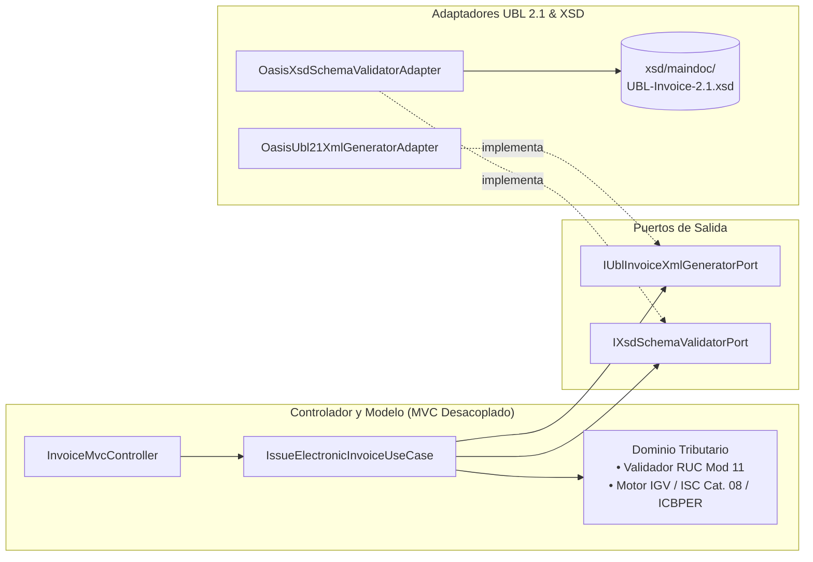

# 📦 ABC Software Corp — Arquitectura, Especificación Spec-First y Motor de Facturación Electrónica OASIS UBL 2.1 (SUNAT)


_%7C_Android_(.apk)-F59E0B?style=for-the-badge)

> **Proyecto Integral de Arquitectura de Software** para la modernización tecnológica y cumplimiento normativo tributario de **ABC Software Corp** (comercializadora de abarrotes y mercadería al por mayor y menor).
>
> El repositorio está estructurado en **tres módulos de ingeniería complementarios**:
> 1. **Módulo I — Caso de Estudio y Análisis Normativo Integral**
> 2. **Módulo II — Especificaciones Técnicas y Contratos (Spec-First)**
> 3. **Módulo III — Motor de Generación y Validación Estricta de XML a partir de `UBL-Invoice-2.1.xsd`**

---

## 🧭 Índice General por Módulos de Ingeniería

### Módulo I — Caso de Estudio y Análisis Normativo Integral
| Documento | Contenido Principal |
| :--- | :--- |
| 📄 [`docs/00-descripcion-del-caso.md`](./docs/00-descripcion-del-caso.md) | Diagnóstico del software básico actual (`fecha`, `ingreso`, `salida`, `producto`, `nro_documento`), exigencias de la SUNAT (**RS N.º 097-2012**, **RS N.º 234-2006**, **Anexo N.º 8** y **Catálogo 08 de ISC**), restricciones arquitectónicas innegociables y descubrimiento de casos de uso con benchmarking frente a **Nubefact**. |

### Módulo II — Diseño Arquitectónico y Especificaciones Técnicas (Spec-First)
| # | Componente de Especificación | Documento Técnico | Contratos y Esquemas Formales |
| :-: | :--- | :--- | :--- |
| **01** | **Modelo de Dominio y Contratos (DTOs / Schemas)** | 📄 [`docs/01-modelo-dominio-y-contratos.md`](./docs/01-modelo-dominio-y-contratos.md) | • [`issue-cpe-command.schema.json`](./specs/schemas/issue-cpe-command.schema.json)<br>• [`cpe-emission-response.schema.json`](./specs/schemas/cpe-emission-response.schema.json)<br>• [`legacy-migration-contract.schema.json`](./specs/schemas/legacy-migration-contract.schema.json)<br>• [`kardex-formal-12-1-13-1.schema.json`](./specs/schemas/kardex-formal-12-1-13-1.schema.json) |
| **02** | **Arquitectura MVC Limpio con Visión a Hexagonal** | 📄 [`docs/02-arquitectura-mvc-a-hexagonal.md`](./docs/02-arquitectura-mvc-a-hexagonal.md) | • [`domain-ports-and-dtos.ts`](./specs/contracts/domain-ports-and-dtos.ts) *(Puertos de Entrada/Salida e Inversión de Dependencias)* |
| **03** | **Especificación de Endpoints / Servicios y Casos de Uso** | 📄 [`docs/03-especificacion-endpoints-y-casos-uso.md`](./docs/03-especificacion-endpoints-y-casos-uso.md) | • [`abc-facturacion-kardex-api.openapi.yaml`](./specs/openapi/abc-facturacion-kardex-api.openapi.yaml) *(OpenAPI 3.1.0)* |
| **04** | **Matriz de Trazabilidad Normativa (SUNAT $\leftrightarrow$ UBL 2.1)** | 📄 [`docs/04-matriz-trazabilidad-normativa-ubl.md`](./docs/04-matriz-trazabilidad-normativa-ubl.md) | • [`20555999113-01-F001-145-ubl21-sample.xml`](./specs/ubl-examples/20555999113-01-F001-145-ubl21-sample.xml) |

### Módulo III — Implementación del Motor Generador y Validador XML (`UBL-Invoice-2.1.xsd`)
| Componente | Ruta en el Repositorio | Descripción Técnica |
| :--- | :--- | :--- |
| **Documentación de Implementación** | 📄 [`docs/05-implementacion-generador-xml-ubl21-xsd.md`](./docs/05-implementacion-generador-xml-ubl21-xsd.md) | Anatomía de `<xs:sequence>` en `UBL-Invoice-2.1.xsd`, arquitectura del generador por puertos y guía de ejecución. |
| **Esquemas XSD Oficiales OASIS** | 📁 [`xsd/maindoc/UBL-Invoice-2.1.xsd`](./xsd/maindoc/UBL-Invoice-2.1.xsd)<br>📁 [`xsd/common/`](./xsd/common/) | Esquemas oficiales OASIS UBL 2.1 completos para validación estructural offline sin dependencias externas. |
| **Núcleo de Dominio Tributario (`M`)** | 🐍 [`src/core_model/domain/entities.py`](./src/core_model/domain/entities.py)<br>🐍 [`src/core_model/domain/ruc_validator.py`](./src/core_model/domain/ruc_validator.py)<br>🐍 [`src/core_model/domain/tax_engine.py`](./src/core_model/domain/tax_engine.py) | Algoritmo **Módulo 11** de RUC, motor matemático de **IGV (18%)**, **ISC Catálogo 08 (`01`, `02`, `03`)**, **ICBPER (`7152`)** y **Bonificaciones (`9996`)**. |
| **Puertos y Casos de Uso (`M`)** | 🐍 [`src/core_model/application/ports.py`](./src/core_model/application/ports.py)<br>🐍 [`src/core_model/application/use_cases.py`](./src/core_model/application/use_cases.py) | Contratos `IUblInvoiceXmlGeneratorPort` e `IXsdSchemaValidatorPort` orquestados por `IssueElectronicInvoiceUseCase`. |
| **Adaptadores UBL 2.1 y XSD** | 🐍 [`src/infrastructure_adapters/ubl21_xml_generator.py`](./src/infrastructure_adapters/ubl21_xml_generator.py)<br>🐍 [`src/infrastructure_adapters/xsd_schema_validator.py`](./src/infrastructure_adapters/xsd_schema_validator.py) | Construcción DOM/XML conforme a `UBL-Invoice-2.1.xsd` y validador XSD con `lxml.etree.XMLSchema`. |
| **Controlador MVC y Demo** | 🐍 [`src/controllers/invoice_controller.py`](./src/controllers/invoice_controller.py)<br>🐍 [`src/demo_generate_and_validate.py`](./src/demo_generate_and_validate.py) | Controlador MVC y demostración ejecutable que genera y valida 3 escenarios reales en [`output/`](./output/). |
| **Comprobantes XML Generados** | 📄 [`output/20555999110-01-F001-145.xml`](./output/20555999110-01-F001-145.xml)<br>📄 [`output/20555999110-01-F001-146.xml`](./output/20555999110-01-F001-146.xml)<br>📄 [`output/20555999110-03-B001-890.xml`](./output/20555999110-03-B001-890.xml)<br>📄 [`output/20600695771-01-F001-145.xml`](./output/20600695771-01-F001-145.xml) | Facturas y Boletas UBL 2.1 generadas por el motor, firmadas con XMLDSig y validadas al 100% contra `UBL-Invoice-2.1.xsd`. |
| **Evidencia CDR SUNAT / Nubefact (`ResponseCode = 0`)** | ✅ [`output/R-20600695771-01-F001-145-cdr-sunat.xml`](./output/R-20600695771-01-F001-145-cdr-sunat.xml) | Constancia de Recepción (`ApplicationResponse`) oficial obtenida en `probar-xml.nubefact.com` (*"La Factura numero F001-145, ha sido aceptada"*). |
| **Suite de Pruebas Automatizadas** | 🧪 [`tests/test_ubl21_invoice_generation.py`](./tests/test_ubl21_invoice_generation.py) | Pruebas unitarias de Módulo 11, Catálogo 08 ISC, tope de S/ 700 en Boletas y conformidad XSD. |

---

## 🏗️ Flujo de Arquitectura: Del Modelo MVC a la Validación `UBL-Invoice-2.1.xsd`



---

## 🚀 Cómo Ejecutar el Generador XML y Validador XSD

```bash
# 1. Instalar dependencias de validación XSD
pip install lxml xmlschema

# 2. Ejecutar la demostración de generación y validación contra UBL-Invoice-2.1.xsd
python -m src.demo_generate_and_validate

# 3. Ejecutar la suite de pruebas automatizadas
python -m unittest discover -s tests -v
```
