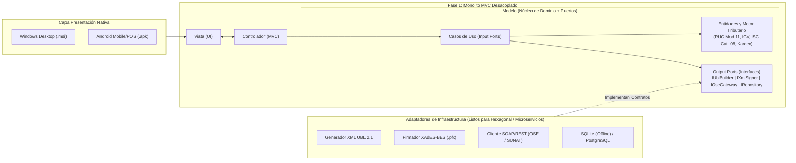

# 📦 ABC Software Corp — Especificación Técnica Spec-First (Facturación Electrónica UBL 2.1 & Kardex SUNAT)


_%7C_Android_(.apk)-F59E0B?style=for-the-badge)

> **Repositorio de Especificaciones Técnicas (Fase 1 - Spec-First)** para la modernización tecnológica y cumplimiento normativo tributario de **ABC Software Corp** (comercializadora de abarrotes y mercadería al por mayor y menor).
>
> Diseñado bajo el principio de **definir reglas matemáticas, contratos de datos, validaciones normativas, puertos arquitectónicos y contratos de interfaz antes de escribir una sola línea de lógica de negocio**.

---

## 📋 Índice de Entregables Principales

| # | Entregable Requerido | Documento de Especificación | Artefactos Técnicos / Contratos Ejecutables |
| :-: | :--- | :--- | :--- |
| **1** | **Modelo de Dominio y Contratos (DTOs / Schemas)** | 📄 [`docs/01-modelo-dominio-y-contratos.md`](./docs/01-modelo-dominio-y-contratos.md) | • [`issue-cpe-command.schema.json`](./specs/schemas/issue-cpe-command.schema.json)<br>• [`cpe-emission-response.schema.json`](./specs/schemas/cpe-emission-response.schema.json)<br>• [`legacy-migration-contract.schema.json`](./specs/schemas/legacy-migration-contract.schema.json)<br>• [`kardex-formal-12-1-13-1.schema.json`](./specs/schemas/kardex-formal-12-1-13-1.schema.json) |
| **2** | **Diagramas de Arquitectura MVC con visión a Hexagonal** | 📄 [`docs/02-arquitectura-mvc-a-hexagonal.md`](./docs/02-arquitectura-mvc-a-hexagonal.md) | • [`domain-ports-and-dtos.ts`](./specs/contracts/domain-ports-and-dtos.ts) *(Puertos de Entrada/Salida e Inversión de Dependencias)* |
| **3** | **Especificación de Endpoints / Servicios (Contratos API) y Casos de Uso** | 📄 [`docs/03-especificacion-endpoints-y-casos-uso.md`](./docs/03-especificacion-endpoints-y-casos-uso.md) | • [`abc-facturacion-kardex-api.openapi.yaml`](./specs/openapi/abc-facturacion-kardex-api.openapi.yaml) *(OpenAPI 3.1.0 completo)* |
| **4** | **Matriz de Trazabilidad Normativa (Cruces SUNAT $\leftrightarrow$ UBL 2.1 $\leftrightarrow$ Legado)** | 📄 [`docs/04-matriz-trazabilidad-normativa-ubl.md`](./docs/04-matriz-trazabilidad-normativa-ubl.md) | • [`20555999113-01-F001-145-ubl21-sample.xml`](./specs/ubl-examples/20555999113-01-F001-145-ubl21-sample.xml) *(XML UBL 2.1 de referencia)* |

---

## 🎯 1. Contexto y Problemática del Caso (AS-IS vs. TO-BE)

**ABC Software Corp** comercializa abarrotes y mercadería al por mayor y menor. Hasta hoy operaba con un software básico de almacén que registraba fichas informales con solo cinco campos:

```text
[ fecha | ingreso | salida | producto | nro_documento ]
```

### Brechas Críticas Resueltas en esta Especificación

| Dimensión | Situación Actual (AS-IS) | Especificación Formal Propuesta (TO-BE) |
| :--- | :--- | :--- |
| **Tributaria y Legal (CPE)** | No emite comprobantes electrónicos ni valida RUCs. | Cumplimiento estricto de **RS N.º 097-2012/SUNAT**, **RS N.º 193-2020/SUNAT** y estándar **OASIS UBL 2.1 (`UBL-Invoice-2.1.xsd`)**. |
| **Cálculo de Impuestos (Abarrotes)** | Sin desglose tributario ni manejo de impuestos especiales. | Motor matemático exacto para **IGV (18%)**, **ISC (Catálogo 08 SUNAT: Sistemas `01` Al Valor, `02` Monto Fijo, `03` PVP)**, **ICBPER (`7152` bolsas plásticas)**, **Exonerados (`9997`)** y **Bonificaciones Gratuitas (`9996`)**. |
| **Almacén y Migración Histórica** | Fichas planas informales sin método de valuación ni códigos SUNAT. | Pipeline ETL con homologación hacia el **Formato 12.1 (Unidades Físicas)** y **Formato 13.1 (Valorizado)** según **RS N.º 234-2006/SUNAT**, conservando trazabilidad inmutable (`legacy_doc_ref` + `SHA-256`). |
| **Firma y Comunicación OSE/SUNAT** | Inexistente. | Firma digital **XAdES-BES (`ds:Signature`)**, validación previa contra XSD, envío a **OSE (Nubefact / SEE-SUNAT)** y **Cola de Contingencia Offline** ante caídas de red. |
| **Arquitectura y Distribución** | Monolito acoplado sin escalabilidad. | **MVC Monolítico Limpio** con inversión de dependencias lista para migrar a **Arquitectura Hexagonal (Ports & Adapters)** y **Microservicios**, distribuido nativamente en **Windows (`.msi`)** y **Android (`.apk`)**. |

---

## 🏗️ 2. Vista Rápida de la Evolución Arquitectónica (MVC $\rightarrow$ Hexagonal)



---

## 📂 3. Estructura del Repositorio

```text
abc-facturacion-ubl-spec/
├── README.md                                           # Resumen ejecutivo y guía de navegación
├── docs/
│   ├── 01-modelo-dominio-y-contratos.md                # 1. Modelo de Dominio, Reglas Matemáticas y DTOs
│   ├── 02-arquitectura-mvc-a-hexagonal.md              # 2. Arquitectura MVC Limpio -> Hexagonal -> Microservicios (.msi / .apk)
│   ├── 03-especificacion-endpoints-y-casos-uso.md      # 3. Casos de Uso (Benchmarking Nubefact) y Contratos API REST
│   └── 04-matriz-trazabilidad-normativa-ubl.md         # 4. Matriz de Trazabilidad SUNAT (Anexo 8 / Cat. 08) <-> UBL-Invoice-2.1.xsd
└── specs/
    ├── schemas/
    │   ├── issue-cpe-command.schema.json               # JSON Schema: Emisión de CPE (Factura, Boleta, NC, ND)
    │   ├── cpe-emission-response.schema.json           # JSON Schema: Respuesta de Emisión, Hash, QR y CDR
    │   ├── legacy-migration-contract.schema.json       # JSON Schema: Migración de datos del software básico
    │   └── kardex-formal-12-1-13-1.schema.json         # JSON Schema: Kardex Formal SUNAT (Formatos 12.1 y 13.1)
    ├── openapi/
    │   └── abc-facturacion-kardex-api.openapi.yaml     # Especificación OpenAPI 3.1.0 completa
    ├── contracts/
    │   └── domain-ports-and-dtos.ts                    # Contratos de Interfaces (Puertos y DTOs en TypeScript estricto)
    └── ubl-examples/
        └── 20555999113-01-F001-145-ubl21-sample.xml    # Ejemplo de Factura XML UBL 2.1 con IGV, ISC Cat. 08, ICBPER y Bonificación
```

---

## 🔍 4. Cómo Validar e Inspeccionar los Contratos

1. **Inspeccionar el Contrato OpenAPI 3.1**:
   - Puedes importar el archivo [`specs/openapi/abc-facturacion-kardex-api.openapi.yaml`](./specs/openapi/abc-facturacion-kardex-api.openapi.yaml) directamente en **Swagger Editor**, **Postman**, **Insomnia** o **Bruno**.
2. **Validar Esquemas JSON (Draft 2020-12)**:
   - Los esquemas en [`specs/schemas/`](./specs/schemas/) son compatibles con cualquier validador estándar (`ajv`, `jsonschema`, `FluentValidation`, `Newtonsoft.Json.Schema`).
3. **Revisar el Mapeo XML UBL 2.1**:
   - El archivo [`specs/ubl-examples/20555999113-01-F001-145-ubl21-sample.xml`](./specs/ubl-examples/20555999113-01-F001-145-ubl21-sample.xml) contiene comentarios línea por línea referenciando los nodos de `UBL-Invoice-2.1.xsd` y los catálogos del **Anexo N.º 8 de SUNAT** (incluyendo **Catálogo 08 - ISC**).
