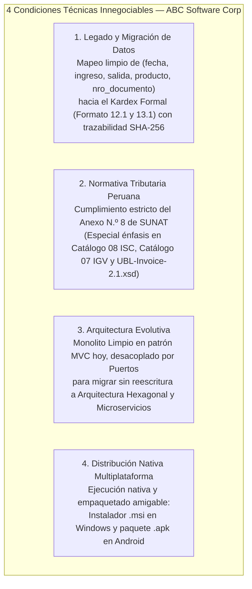

# Descripción Integral del Caso de Estudio: ABC Software Corp

> **Módulo I — Contexto de Negocio, Problemática Tributaria, Restricciones Arquitectónicas y Descubrimiento de Casos de Uso**

---

## 1. Contexto Organizacional y Situación Actual (AS-IS)

**ABC Software Corp** es una empresa mediana peruana dedicada a la comercialización de abarrotes y mercadería al por mayor y menor (sacos de arroz, azúcar, menestras, aceites, bebidas gaseosas, licores, productos de consumo masivo y bolsas plásticas).

Actualmente, la empresa opera con un **software básico de almacén** que únicamente registra movimientos diarios en fichas planas e informales con cinco campos:

| Campo Actual | Tipo Informal | Ejemplo de Registro Actual | Limitación Técnica y Legal |
| :--- | :--- | :--- | :--- |
| **`fecha`** | Texto sin estándar | `"15/03/2025"` | Sin zona horaria ni control de cierre de periodo contable (`YYYYMM`). |
| **`ingreso`** | Número simple | `50` | Sin costo unitario de entrada ni diferenciación entre Compra (`02`), Saldo Inicial (`16`) o Devolución (`05`). |
| **`salida`** | Número simple | `12` | Sin costo promedio ponderado de salida ni vínculo a un comprobante electrónico real. |
| **`producto`** | Texto libre | `"Arroz Extra x 50kg"` | Sin código SKU estandarizado, sin unidad UN/ECE Rec 20 (**Catálogo 03**) ni código SUNAT UNSPSC (**Catálogo 25**). |
| **`nro_documento`** | Texto informal | `"VALE-0089"` o `"S/N"` | Numeración interna sin validez tributaria (no respeta series `F001`/`B001` ni **Tabla 10 SUNAT**). |

---

## 2. Problemática Normativa y Exigencias de la SUNAT

La **SUNAT**, a través de la **Resolución de Superintendencia N.º 097-2012/SUNAT** (Sistema de Emisión Electrónica), la **RS N.º 234-2006/SUNAT** (Libros y Registros vinculados a asuntos tributarios), la **RS N.º 193-2020/SUNAT** (requisitos de pago al crédito/cuotas) y la masificación de Comprobantes de Pago Electrónicos (CPE), exige que la empresa formalice íntegramente sus operaciones bajo el estándar internacional **OASIS UBL 2.1 (Universal Business Language)** y el esquema **`UBL-Invoice-2.1.xsd`**.

### Vacíos Críticos del Sistema Actual frente a la SUNAT:
1. **Ausencia de Validación de RUC**: No valida la estructura ni el dígito verificador mediante el **Algoritmo Módulo 11** (**Catálogo 06 = `6`**), ni verifica el tope de **S/ 700.00** para identificación obligatoria con DNI en Boletas de Venta.
2. **Inexistencia de Motor Tributario Multicapa**:
   - No calcula el **IGV (18%)** diferenciando operaciones Gravadas (`10`), Exoneradas (`20`), Inafectas (`30`) y **Transferencias Gratuitas / Bonificaciones (`11` al `16` — Tributo `9996`)**, muy frecuentes en ventas mayoristas de abarrotes.
   - No implementa el **Catálogo N.º 08 de SUNAT (Sistemas de Cálculo del ISC — Tributo `2000`)** para bebidas azucaradas, cervezas y licores (`01` Sistema al Valor, `02` Aplicación del Monto Fijo, `03` Sistema de Precios de Venta al Público), ni su impacto directo sobre la base imponible del IGV.
   - No calcula el **ICBPER (`7152`)** para el impuesto al consumo de bolsas plásticas.
3. **Incapacidad de Generar y Validar XML UBL 2.1 (`UBL-Invoice-2.1.xsd`)**: No construye el árbol XML con los namespaces `cac:`, `cbc:`, `ext:`, `ds:`, ni valida la estructura contra el esquema XSD oficial de OASIS, ni inserta la firma digital **XAdES-BES**.
4. **Falta de Integración con OSE / SUNAT y Contingencia**: No transmite paquetes ZIP ni procesa Constancias de Recepción (**CDR**), ni cuenta con una cola local para operar cuando falla el internet o cae el servicio de la SUNAT.

---

## 3. Alcance Técnico y Condiciones Arquitectónicas Innegociables

La gerencia de **ABC Software Corp** estableció cuatro pilares técnicos obligatorios que rigen todo el diseño e implementación del repositorio:

1. **Metodología Spec-First**: Antes de escribir la lógica de negocio, se definen formalmente las reglas matemáticas, los esquemas de validación (JSON Schemas), los contratos de puertos (Interfaces), los contratos de servicios (OpenAPI 3.1) y la matriz de trazabilidad contra `UBL-Invoice-2.1.xsd`.
2. **Legado y Migración de Datos sin Pérdida de Trazabilidad**: Cada ficha histórica se conserva en una entidad inmutable de auditoría (`LEGACY_RAW_MOVEMENTS`) y se homologa hacia el **Registro de Inventario Permanente (Formatos 12.1 y 13.1)** usando la serie interna `MIG01` y **Tabla 10 = `00` (Otros)**.
3. **Arquitectura MVC Limpio con Visión a Hexagonal**: La capa **Modelo (`M`)** aísla el dominio puro y expone **Puertos de Entrada y Salida**, permitiendo que el generador de XML UBL 2.1 y el validador `UBL-Invoice-2.1.xsd` funcionen como **Adaptadores de Infraestructura** intercambiables.
4. **Distribución Nativa (`.msi` / `.apk`)**: Preparado para empaquetarse como instalador nativo `.msi` (vía WiX Toolset en Windows) y `.apk` (en dispositivos móviles/POS Android).

---

## 4. Descubrimiento de Casos de Uso (Benchmarking con Nubefact)

A partir de la evaluación de plataformas líderes de facturación electrónica en el Perú (como **Nubefact DEMO**) y el levantamiento de las quejas reales de usuarios en el sector abarrotes, el sistema cubre los siguientes flujos operativos:

| Código | Caso de Uso | Valor de Negocio / Regla SUNAT Aplicada |
| :---: | :--- | :--- |
| **CU-01** | **Emisión de Factura Electrónica (`01`) Mayorista (Contado / Crédito)** | Valida RUC con Módulo 11, soporta múltiples tasas e impuestos (IGV, ISC Catálogo 08, ICBPER) y exige cronograma de cuotas si es al crédito (RS 193-2020). |
| **CU-02** | **Emisión de Boleta de Venta (`03`) Minorista** | Permite emisión rápida a *Clientes Varios (`00000000`)* hasta S/ 700.00 y exige DNI (`Catálogo 06 = 1`) cuando supera dicho umbral. |
| **CU-03** | **Gestión de Bonificaciones y Transferencias Gratuitas en Abarrotes** | Maneja promociones mayoristas (ej. *"Por 10 sacos, 1 botella de aceite gratis"*) usando `PricingReference` con valor referencial (**Catálogo 16 = `02`**) y tributo `9996` (`GRA`). |
| **CU-04** | **Generación y Validación Estricta de XML desde `UBL-Invoice-2.1.xsd`** | Construye el documento XML UBL 2.1 respetando el orden secuencial de nodos de OASIS y lo valida automáticamente contra el esquema oficial `UBL-Invoice-2.1.xsd`. |
| **CU-05** | **Emisión de Notas de Crédito (`07`) y Débito (`08`) con Reversión en Kardex** | Vincula el documento modificado (`cac:BillingReference`), aplica motivos de los **Catálogos 09 y 10** y reingresa automáticamente la mercadería devuelta al Kardex. |
| **CU-06** | **Operación Resiliente con Cola de Contingencia Offline** | Permite seguir facturando e imprimiendo tickets con código QR y Resumen Hash (`ds:DigestValue`) aun cuando el servicio de SUNAT/OSE presente caídas temporales. |
| **CU-07** | **Migración y Homologación de Fichas Históricas de Almacén** | Convierte los registros legados (`fecha`, `ingreso`, `salida`, `producto`, `nro_documento`) al Kardex Formal valorizado por **Costo Promedio Ponderado**. |
