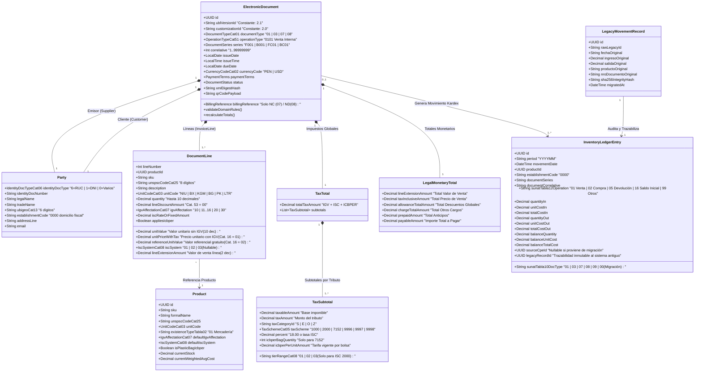
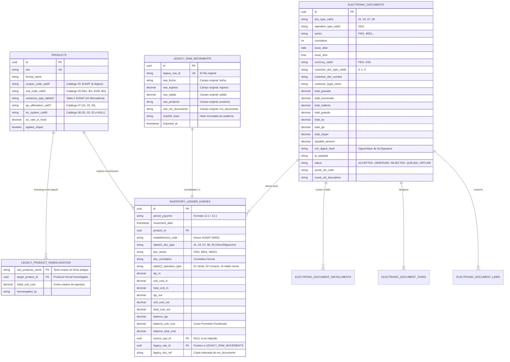

# 1. Modelo de Dominio y Contratos de Datos (DTOs / Schemas)

> **Entregable 1 — Metodología Spec-First**
> Define formalmente las entidades, objetos de valor, invariantes matemáticas tributarias (RUC Módulo 11, IGV, ISC Catálogo 08, ICBPER, Bonificaciones), el modelo de migración de datos históricos del almacén y los contratos de transferencia de datos (DTOs / JSON Schemas).

---

## 1.1 Diseño Estratégico del Dominio (Bounded Contexts)

Para evitar que el sistema herede el desorden del software básico anterior, el modelo de dominio se estructura en **dos subdominios principales** comunicados por identificadores inmutables:

1. **Subdominio de Facturación Electrónica (`Billing & UBL Core`)**:
   - Responsable de estructurar, validar y calcular Comprobantes de Pago Electrónicos (Facturas `01`, Boletas `03`, Notas de Crédito `07` y Notas de Débito `08`) bajo el estándar **OASIS UBL 2.1** y el **Anexo N.º 8 de la RS N.º 097-2012/SUNAT**.
2. **Subdominio de Inventario Permanente y Migración (`Inventory & Legacy Migration Core`)**:
   - Responsable de llevar el **Kardex Físico (Formato 12.1)** y **Kardex Valorizado (Formato 13.1)** bajo la **RS N.º 234-2006/SUNAT**, así como de ingerir, homologar y auditar las fichas históricas del sistema legado (`fecha`, `ingreso`, `salida`, `producto`, `nro_documento`).

---

## 1.2 Diagrama de Clases del Modelo de Dominio

---

## 1.3 Modelo Entidad-Relación (Persistencia Relacional y Trazabilidad de Migración)

El esquema relacional está diseñado para funcionar idénticamente sobre **SQLite** (en modo local/offline para Windows `.msi` y Android `.apk`) y sobre **PostgreSQL** (en el despliegue centralizado/microservicios).

---

## 1.4 Especificación de Reglas e Invariantes Matemáticas

### A. Invariante 1: Validación de RUC con Algoritmo Módulo 11 (`Catálogo 06 = 6`)
El sistema rechaza en la frontera del dominio cualquier intento de emitir una Factura (`01`) cuyo cliente no posea un RUC válido:
1. Expresión regular: `^(10|15|16|17|20)\d{9}$` (exactamente 11 dígitos numéricos).
2. Cálculo del dígito verificador $d_{11}$ con pesos $W = [5, 4, 3, 2, 7, 6, 5, 4, 3, 2]$:
   $$S = \sum_{i=1}^{10} d_i \cdot W_i, \quad R = 11 - (S \bmod 11)$$
   $$d_{11}^{\text{calculado}} = \begin{cases} 0 & \text{si } R = 10 \\ 1 & \text{si } R = 11 \\ R & \text{si } R \in [1..9] \end{cases}$$
   Si $d_{11} \neq d_{11}^{\text{calculado}}$, se lanza `ERR_INVALID_RUC_MOD11`.

---

### B. Invariante 2: Reglas de Identificación en Boletas de Venta (`Catálogo 01 = 03`)
- Si $\text{PayableAmount} \le \text{S/ } 700.00$, se permite emitir a **Clientes Varios** con `Catálogo 06 = 0` y número `"00000000"`.
- Si $\text{PayableAmount} > \text{S/ } 700.00$, es **obligatorio** identificar al adquirente con DNI (`Catálogo 06 = 1`, 8 dígitos `^\d{8}$`), Carnet de Extranjería (`4`) o RUC (`6`). De lo contrario, se lanza `ERR_BOLETA_IDENTIFICATION_REQUIRED_OVER_700`.

---

### C. Invariante 3: Motor Matemático de Impuestos (IGV, Catálogo 08 ISC, ICBPER y Gratuitas)

Para cada línea $i$ del comprobante:

1. **Precisión Decimal (Prevención del Error SUNAT `2017` / `3205`)**:
   - Cantidad (`cbc:InvoicedQuantity`) y Valor Unitario sin impuestos (`cac:Price/cbc:PriceAmount`): **hasta 10 decimales**.
   - Importes totales de línea (`cbc:LineExtensionAmount`) y montos de tributos (`cbc:TaxAmount`): **redondeo comercial Half-Up a 2 decimales** (`ROUND_HALF_UP`).

2. **Cálculo del ISC según el Catálogo N.º 08 de SUNAT (`TierRange` / `TaxScheme = 2000`)**:
   En la comercialización de abarrotes al por mayor y menor (cervezas, licores, bebidas azucaradas, cigarrillos), el **Catálogo N.º 08** define tres fórmulas mutuamente excluyentes:
   - **Código `01` — Sistema al Valor**:
     $$\text{Base}_{\text{ISC},i} = VV_i = \text{round}(Q_i \times V_{u,i} - D_i, 2)$$
     $$\text{ISC}_i = \text{round}\left(\text{Base}_{\text{ISC},i} \times \frac{\text{Tasa}_{\text{ISC}}}{100}, 2\right)$$
   - **Código `02` — Aplicación del Monto Fijo (Específico en Soles por unidad/litro)**:
     $$\text{ISC}_i = \text{round}\left(Q_i \times \text{MontoFijo}_{\text{ISC}}, 2\right)$$
   - **Código `03` — Sistema de Precios de Venta al Público (PVP)**:
     $$\text{Base}_{\text{ISC},i} = \text{round}\left(Q_i \times P_{\text{PVP},i} \times 0.909, 2\right)$$
     $$\text{ISC}_i = \text{round}\left(\text{Base}_{\text{ISC},i} \times \frac{\text{Tasa}_{\text{ISC}}}{100}, 2\right)$$

3. **Impacto del ISC sobre la Base Imponible del IGV (`TaxScheme = 1000`)**:
   Por mandato de la Ley del IGV e ISC (TUO D.S. 055-99-EF), el ISC forma parte de la base imponible del IGV:
   $$\text{Base}_{\text{IGV},i} = VV_i + \text{ISC}_i$$
   $$\text{IGV}_i = \text{round}\left(\text{Base}_{\text{IGV},i} \times 0.18, 2\right)$$

4. **Bonificaciones y Transferencias Gratuitas (`Catálogo 07` $\in \{11..16\}$, `TaxScheme = 9996`)**:
   Común en abarrotes mayoristas (ej. *"Por la compra de 10 sacos, 1 saco de bonificación"*):
   - `cbc:PriceAmount` en `cac:Price` = `0.00`.
   - `cbc:PriceTypeCode` en `cac:PricingReference` = `"02"` (Valor referencial unitario en operaciones no onerosas, **Catálogo 16**).
   - `cbc:LineExtensionAmount` = $\text{round}(Q_i \times V_{\text{ref},i}, 2)$, pero **NO se suma** al `LegalMonetaryTotal/PayableAmount`.

5. **Impuesto al Consumo de las Bolsas de Plástico — ICBPER (`TaxScheme = 7152`)**:
   $$\text{ICBPER}_i = N_{\text{bolsas},i} \times 0.50 \text{ PEN}$$

---

### D. Invariante 4: Valuación de Inventario por Costo Promedio Ponderado (Formato 13.1 SUNAT)
Cada movimiento de entrada actualiza el costo unitario promedio ponderado ($CPP_t$) del producto:
- **En un Ingreso (Compra `Tabla 12 = 02`, Devolución de cliente `05` o Saldo Inicial Migrado `16`)**:
  $$CPP_t = \frac{(Q_{\text{saldo}, t-1} \times CPP_{t-1}) + (Q_{\text{ingreso}, t} \times C_{\text{ingreso}, t})}{Q_{\text{saldo}, t-1} + Q_{\text{ingreso}, t}}$$
- **En una Salida (Venta por Factura/Boleta `Tabla 12 = 01`)**:
  El costo unitario de salida es $C_{\text{salida}, t} = CPP_{t-1}$, manteniendo invariante el $CPP$ hasta la siguiente entrada.

---

## 1.5 Contratos formales de Datos (JSON Schemas Ejecutables)

Los esquemas formales bajo el estándar **JSON Schema Draft 2020-12** se encuentran listos para validación automatizada en la carpeta [`specs/schemas/`](../specs/schemas/):

1. **[`specs/schemas/issue-cpe-command.schema.json`](../specs/schemas/issue-cpe-command.schema.json)**: Contrato de entrada para emisión de Facturas, Boletas, Notas de Crédito y Notas de Débito.
2. **[`specs/schemas/cpe-emission-response.schema.json`](../specs/schemas/cpe-emission-response.schema.json)**: Contrato de salida con resumen tributario, Hash `DigestValue`, cadena QR oficial SUNAT, respuesta CDR y referencias de movimiento Kardex.
3. **[`specs/schemas/legacy-migration-contract.schema.json`](../specs/schemas/legacy-migration-contract.schema.json)**: Contrato de migración masiva para transformar las fichas antiguas (`fecha`, `ingreso`, `salida`, `producto`, `nro_documento`) con homologación de catálogo y validación en seco (`DRY_RUN`).
4. **[`specs/schemas/kardex-formal-12-1-13-1.schema.json`](../specs/schemas/kardex-formal-12-1-13-1.schema.json)**: Contrato de representación de los Libros Electrónicos Formato 12.1 y Formato 13.1 de la RS N.º 234-2006/SUNAT.
