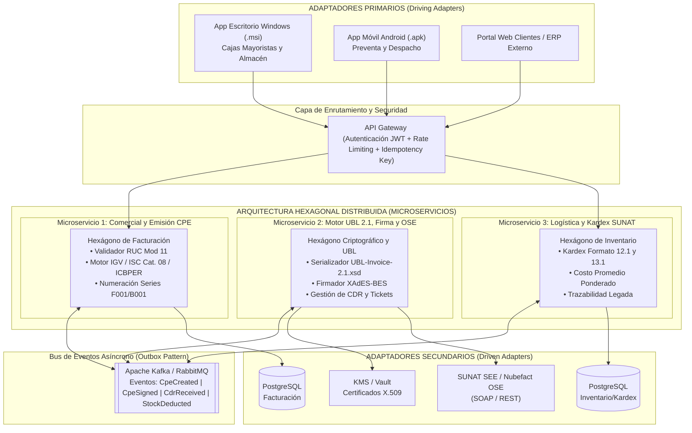
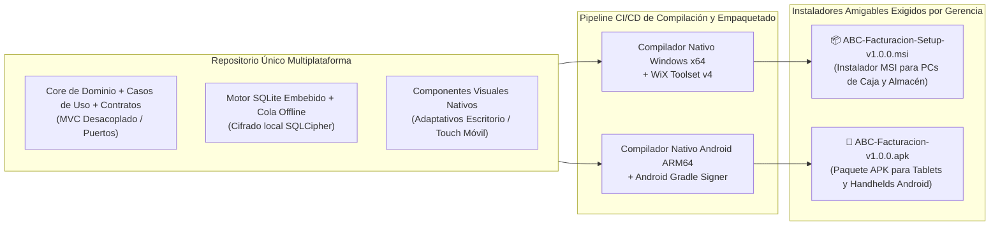

# 2. Diagramas de Arquitectura: MVC Monolítico Limpio con Visión a Arquitectura Hexagonal y Microservicios

> **Entregable 2 — Metodología Spec-First**
> Cumple la condición arquitectónica innegociable de la gerencia: iniciar con un **Monolito Limpio basado en el patrón MVC (Modelo-Vista-Controlador)** cuyo diseño interno esté desacoplado mediante **Puertos e Inversión de Dependencias (SOLID)** para migrar sin fricción hacia una **Arquitectura Hexagonal (Ports & Adapters)**, escalar a **Microservicios** y distribuirse nativamente en **Windows (`.msi`)** y **Android (`.apk`)**.

---

## 2.1 Principio Rector: ¿Cómo diseñar un MVC hoy que sea Hexagonal mañana?

El error clásico en una arquitectura MVC tradicional es acoplar el **Controlador** o el **Modelo** directamente a detalles de infraestructura (sentencias SQL, librerías SOAP de SUNAT, lectura de certificados `.pfx` en disco o serializadores XML).

Para garantizar una transición **cero-reescritura** hacia Arquitectura Hexagonal, aplicamos la **Regla de Inversión de Dependencias (DIP)** dentro de la capa **Modelo (`M`)**:

1. **La Vista (`V`)**: Renderiza pantallas nativas en Windows y Android. No contiene lógica tributaria ni de redondeo.
2. **El Controlador (`C`)**: Recibe eventos de la Vista o peticiones HTTP, valida el formato sintáctico de los DTOs y delega la ejecución a un **Puerto de Entrada (Caso de Uso)** del Modelo.
3. **El Modelo (`M`) se divide en dos anillos concéntricos**:
   - **Anillo Interno (Dominio Puro)**: Entidades (`ElectronicDocument`, `InventoryLedgerEntry`), Objetos de Valor (`RucNumber`, `DocumentSeries`) y Motores de Cálculo (`TaxCalculationEngine`, `WeightedAverageCostService`). **Cero dependencias externas**.
   - **Anillo de Aplicación y Puertos (Contratos)**: Casos de Uso (`IssueCpeUseCase`, `MigrateLegacyKardexUseCase`) que se comunican con el mundo exterior exclusivamente a través de **Interfaces (Puertos de Salida)**: `IUbl21XmlBuilderPort`, `IXmlDigitalSignerPort`, `ISunatOseGatewayPort`, `IInvoiceRepositoryPort`.
4. **Adaptadores de Infraestructura**: Clases concretas situadas fuera del núcleo del Modelo que implementan los Puertos de Salida.

---

## 2.2 Fase 1 (Actual): Diagrama de Arquitectura MVC Monolítica Limpia

```mermaid
flowchart TB
    subgraph MultiplatformUI["CAPA VISTA (V - Presentación Nativa Multiplataforma)"]
        direction LR
        UI_POS["Vista Emisión CPE\n(Factura / Boleta / NC / ND)"]
        UI_KAR["Vista Kardex SUNAT\n(Formato 12.1 y 13.1)"]
        UI_MIG["Vista Migración Legada\n(Homologación y Auditoría)"]
    end

    subgraph Controllers["CAPA CONTROLADOR (C - Orquestación y Validación de Contratos)"]
        direction LR
        CTRL_CPE["CpeController\n(Mapea IssueCpeCommandDto)"]
        CTRL_KAR["KardexController\n(Consultas y Reportes)"]
        CTRL_MIG["MigrationController\n(Mapea LegacyMigrationContract)"]
    end

    subgraph CleanModel["CAPA MODELO (M - Núcleo de Dominio y Aplicación Desacoplado)"]
        direction TB
        subgraph DrivingPorts["Puertos de Entrada (Use Case Interfaces)"]
            IN_ISSUE["IIssueCpeUseCase"]
            IN_VOID["IVoidAndSummaryUseCase"]
            IN_MIG["IMigrateLegacyKardexUseCase"]
            IN_RUC["IValidateRucUseCase"]
        end

        subgraph DomainLayer["Núcleo de Dominio Tributario y de Almacén (100% Puro)"]
            DOM_TAX["TaxCalculationEngine\n• IGV 18% (Cat. 07)\n• ISC Sistemas 01, 02, 03 (Cat. 08)\n• ICBPER Bolsas (7152)\n• Gratuitas (9996)"]
            DOM_RUC["RucMod11Validator\n(Algoritmo Módulo 11 SUNAT)"]
            DOM_KARDEX["KardexValuationEngine\n(Costo Promedio Ponderado - Tabla 5)"]
        end

        subgraph DrivenPorts["Puertos de Salida (Interfaces de Infraestructura)"]
            OUT_UBL["IUbl21XmlBuilderPort"]
            OUT_SIGN["IXmlDigitalSignerPort"]
            OUT_OSE["ISunatOseGatewayPort"]
            OUT_REPO["IUnitOfWork & Repositories"]
            OUT_QUEUE["IOfflineContingencyQueuePort"]
        end
    end

    subgraph InfrastructureAdapters["CAPA DE ADAPTADORES DE INFRAESTRUCTURA (Inyectados por DI)"]
        direction LR
        AD_UBL["OasisUbl21XmlAdapter\n(Validador UBL-Invoice-2.1.xsd)"]
        AD_SIGN["XadesBesPkcs12Adapter\n(Firma RSA-SHA256 + Hash)"]
        AD_OSE["SunatOseClientAdapter\n(Nubefact OSE / SUNAT Beta/Prod)"]
        AD_DB["SqliteOrPostgresAdapter\n(Persistencia ACID)"]
        AD_SYNC["OfflineRetryWorkerAdapter\n(Cola de Contingencia)"]
    end

    UI_POS <--> CTRL_CPE
    UI_KAR <--> CTRL_KAR
    UI_MIG <--> CTRL_MIG

    CTRL_CPE --> IN_ISSUE
    CTRL_CPE --> IN_VOID
    CTRL_CPE --> IN_RUC
    CTRL_KAR --> OUT_REPO
    CTRL_MIG --> IN_MIG

    IN_ISSUE --> DOM_TAX
    IN_ISSUE --> DOM_RUC
    IN_ISSUE --> DOM_KARDEX
    IN_ISSUE --> DrivenPorts
    IN_MIG --> DOM_KARDEX
    IN_MIG --> OUT_REPO

    AD_UBL -. "implementa" .-> OUT_UBL
    AD_SIGN -. "implementa" .-> OUT_SIGN
    AD_OSE -. "implementa" .-> OUT_OSE
    AD_DB -. "implementa" .-> OUT_REPO
    AD_SYNC -. "implementa" .-> OUT_QUEUE
```



---

## 2.3 Estructura Modular del Proyecto (Preparada para Extracción Hexagonal)

```text
src/
├── presentation/                         # [V] Vistas nativas (Windows Desktop / Android Mobile)
│   ├── views/
│   └── viewmodels/
├── controllers/                          # [C] Controladores MVC ( solo conocen DTOs y Puertos de Entrada )
│   ├── CpeController.ts
│   ├── KardexController.ts
│   └── LegacyMigrationController.ts
├── core-model/                           # [M] EL FUTURO HEXÁGONO (Cero imports de BD, Red o UI)
│   ├── domain/
│   │   ├── entities/                     # ElectronicDocument, DocumentLine, InventoryLedgerEntry
│   │   ├── value-objects/                # RucNumber (Mod 11), DocumentSeries, Money, TaxAffectation
│   │   ├── services/                     # TaxCalculationEngine (IGV, ISC Cat. 08, ICBPER), KardexValuationService
│   │   └── errors/                       # DomainError, SunatCatalogValidationError
│   └── application/
│       ├── ports/
│       │   ├── in/                       # IIssueCpeUseCase, IMigrateLegacyKardexUseCase
│       │   └── out/                      # IUbl21XmlBuilderPort, IXmlDigitalSignerPort, ISunatOseGatewayPort
│       ├── use-cases/                    # Implementación orquestadora de los Casos de Uso
│       └── dtos/                         # Contratos de transferencia validados por JSON Schema
└── infrastructure-adapters/              # Adaptadores enchufables (Reemplazables al pasar a Microservicios)
    ├── ubl-xml/                          # Generador UBL 2.1 + Validador local XSD (UBL-Invoice-2.1.xsd)
    ├── digital-signature/                # Firmador XAdES-BES (XMLDSig) con Certificado X.509 (.pfx)
    ├── sunat-ose-gateway/                # Adaptador SOAP/REST hacia OSE (Nubefact) o SUNAT SOL
    ├── persistence/                      # Repositorios SQLite (modo local) / PostgreSQL (modo servidor)
    └── offline-contingency/              # Cola persistente para reintentos automáticos de envío CDR
```

---

## 2.4 Fase 2 y 3: Transición a Arquitectura Hexagonal y Escalabilidad a Microservicios

Cuando **ABC Software Corp** expanda sus operaciones (múltiples almacenes mayoristas, tiendas minoristas y facturación masiva concurrente), el directorio `core-model/` se mantiene **100% intacto** y la arquitectura evoluciona desacoplando los adaptadores en microservicios independientes:



### Matriz de Evolución Arquitectónica (Cero Reescritura de Negocio)

| Componente | Etapa 1: Monolito MVC Limpio | Etapa 2: Arquitectura Hexagonal | Etapa 3: Microservicios |
| :--- | :--- | :--- | :--- |
| **`TaxCalculationEngine` (IGV, ISC Cat. 08, ICBPER)** | Clase de dominio en `core-model/domain` | Exactamente la misma clase (0 cambios) | Empaquetada en `MS-Facturacion` (0 cambios) |
| **`CpeController`** | Controlador MVC local en proceso | Adaptador Primario REST / UI | Endpoint en `MS-Facturacion` detrás de API Gateway |
| **`IUbl21XmlBuilderPort` & `IXmlDigitalSignerPort`** | Implementados en memoria en el mismo proceso | Adaptadores Secundarios intercambiables | Extraídos a `MS-UblSigner` invocado por eventos o gRPC |
| **Persistencia (`IInvoiceRepositoryPort`)** | Adaptador SQLite local / PostgreSQL | Adaptador de Persistencia desacoplado | Base de datos por microservicio con patrón *Transactional Outbox* |

---

## 2.5 Arquitectura de Distribución Multiplataforma Nativa (`.msi` y `.apk`) y Contingencia Offline

La gerencia exige que la aplicación corra de manera nativa en **Windows (`.msi`)** y **Android (`.apk`)**, y que no detenga la operación del almacén o caja cuando falle la conexión con SUNAT/OSE.



### Especificación de Empaquetado e Instalación
1. **Entorno Windows (`.msi`)**:
   - Generado mediante **WiX Toolset** con asistente gráfico amigable, creación de acceso directo en Escritorio, registro de carpeta segura para el Certificado Digital `.pfx` en `%APPDATA%\ABCSoftware\certs` y servicio de sincronización en segundo plano.
2. **Entorno Android (`.apk`)**:
   - Compilado nativamente para arquitecturas `arm64-v8a` y `armeabi-v7a`, con soporte para impresoras térmicas Bluetooth/Red ESC/POS (tickets de 58mm/80mm con código QR de SUNAT) y lector de código de barras por cámara o láser integrado.
