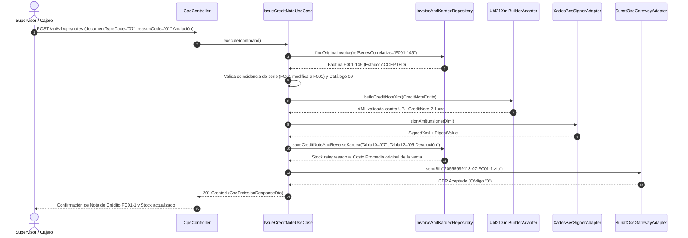
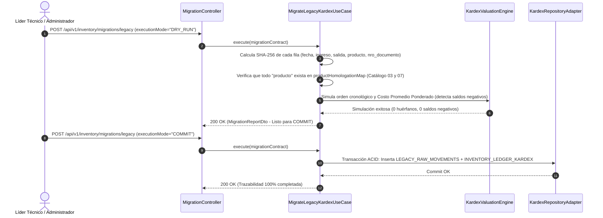

# 3. Descubrimiento de Casos de Uso y Especificación de Endpoints / Servicios (Contratos API)

> **Entregable 3 — Metodología Spec-First**
> Detalla los casos de uso descubiertos a partir de las necesidades del rubro de abarrotes mayorista/minorista, el análisis de dolores reales de usuarios peruanos de facturación electrónica y el benchmarking funcional con plataformas OSE/PSE de referencia como **Nubefact**. Define además los contratos formales de los servicios RESTful.

---

## 3.1 Análisis de Dolores de Usuarios y Benchmarking con Nubefact

Al analizar el flujo operativo de **Nubefact** y las incidencias más comunes reportadas por comercios mayoristas y minoristas de abarrotes ante la SUNAT, se identificaron **7 dolores críticos** que nuestras especificaciones resuelven de raíz antes de escribir código:

| # | Dolor Frecuente del Usuario en Facturación Electrónica | Cómo lo resuelve Nubefact / Estándar OSE | Regla Spec-First Incorporada en ABC Software Corp |
| :-: | :--- | :--- | :--- |
| **1** | **Rechazo por descuadre de céntimos (`Error SUNAT 2017 / 3205`)** al vender abarrotes por peso o paquetes a precios con IGV incluido. | Maneja valores unitarios con hasta 10 decimales y redondea subtotales a 2 decimales. | El contrato `IssueCpeCommandDto` exige `unitValue` de hasta 10 decimales y valida localmente la tolerancia SUNAT ($\pm \text{S/ } 1.00$) antes de firmar. |
| **2** | **Caídas o lentitud de SUNAT / corte de internet en tienda** que paralizan la cola de clientes en caja. | Emisión asíncrona con firma local inmediata y reenvío automático por lotes. | Estado `QUEUED_OFFLINE` (HTTP `202 Accepted`): firma el XML localmente, extrae el `DigestValue` (Hash), imprime el ticket QR de inmediato y sincroniza el CDR en segundo plano. |
| **3** | **Ventas mayoristas con bonificaciones ("Por 10 cajas de leche, 1 botella de aceite gratis")** mal declaradas que hacen pagar IGV de más o generan multas. | Permite líneas de *Transferencia Gratuita* con valor referencial (`Catálogo 16 = 02`) y afectación `Catálogo 07` (`11` al `16`). | Soporte nativo de `referenceUnitValue` con tributo `9996` (`GRATUITO`), que descuenta stock del Kardex pero no altera el `PayableAmount`. |
| **4** | **Bebidas alcohólicas, gaseosas y productos con ISC** donde el usuario no sabe cómo afecta el ISC al IGV. | Selector del **Catálogo 08 de SUNAT** (`01` Al Valor, `02` Monto Fijo, `03` PVP) que suma automáticamente el ISC a la base del IGV. | El motor `TaxCalculationEngine` calcula primero el ISC según el **Catálogo 08** y lo adiciona automáticamente al `TaxableAmount` del IGV (`1000`). |
| **5** | **Boletas mayores a S/ 700 emitidas a "Clientes Varios"** rechazadas por SUNAT (`Error 2800 / 2801`). | Bloqueo preventivo en interfaz y API exigiendo DNI (`Catálogo 06 = 1`). | Regla invariante de dominio: si `documentTypeCode == "03"` y `payableAmount > 700.00 PEN`, rechaza con HTTP `422` si `identityDocType == "0"`. |
| **6** | **Facturas al crédito rechazadas (`Error 3244`)** por no detallar las cuotas ni fechas de vencimiento (RS 193-2020/SUNAT). | Desglose obligatorio de `FormaPago: Credito` y lista de `Cuota001...CuotaN`. | El esquema JSON valida que si `paymentTerms.condition == "Credito"`, el arreglo `installments` sea obligatorio y sume exactamente el monto neto pendiente. |
| **7** | **Desfase entre lo facturado y el stock real del almacén (Kardex)** cuando hay devoluciones o anulaciones. | Enlaza cada Factura, Boleta y Nota de Crédito con el movimiento de inventario. | Transacción atómica: emitir una Factura/Boleta genera una salida (`Tabla 12 = 01`); emitir una Nota de Crédito tipo `01` o `06` genera un ingreso por devolución (`Tabla 12 = 05`). |

---

## 3.2 Catálogo de Casos de Uso y Criterios de Aceptación (BDD / Gherkin)

### CU-01: Emitir Factura Electrónica (`01`) Mayorista con IGV, ISC (Catálogo 08) e ICBPER
```gherkin
Característica: Emisión de Factura Electrónica UBL 2.1 para venta mayorista de abarrotes

  Escenario: Factura al contado con arroz (Gravado 10), gaseosas (ISC Catálogo 08 = 01) y bolsas plásticas (ICBPER 7152)
    Dado que el cliente tiene el RUC "20601234561" que cumple con el algoritmo Módulo 11 y está "ACTIVO" y "HABIDO"
    Y el cajero registra 10 sacos de arroz a valor unitario S/ 140.00 (Catálogo 07 = "10")
    Y registra 5 packs de gaseosa a valor unitario S/ 30.00 afecto a ISC Sistema al Valor (Catálogo 08 = "01", tasa 25%)
    Y registra 2 bolsas plásticas afectas a ICBPER (Catálogo 05 = "7152", tarifa S/ 0.50 c/u)
    Cuando el controlador envía el comando a "POST /api/v1/cpe/documents"
    Entonces el motor tributario calcula:
      | Concepto                        | Monto (PEN) | Nodo UBL 2.1 Asociado                         |
      | Valor Venta Total               |     1550.20 | LegalMonetaryTotal/LineExtensionAmount        |
      | Total ISC (Cat. 08 = 01)        |       37.50 | TaxTotal/TaxSubtotal[TaxScheme=2000]          |
      | Base Imponible IGV (VV + ISC)   |     1587.70 | TaxTotal/TaxSubtotal[TaxScheme=1000]          |
      | Total IGV (18%)                 |      285.79 | TaxTotal/TaxSubtotal[TaxScheme=1000]          |
      | Total ICBPER (2 bolsas)         |        1.00 | TaxTotal/TaxSubtotal[TaxScheme=7152]          |
      | Importe Total a Pagar           |     1874.49 | LegalMonetaryTotal/PayableAmount              |
    Y se genera el XML conforme a "UBL-Invoice-2.1.xsd", firmado con XAdES-BES
    Y se descuentan las unidades en el Kardex Formal (Tabla 10 = "01", Tabla 12 = "01")
```

### CU-02: Emitir Boleta de Venta (`03`) Minorista con Regla de Tope S/ 700.00
```gherkin
Característica: Control de identificación obligatoria en Boletas de Venta

  Escenario: Rechazo preventivo de Boleta mayor a S/ 700.00 sin DNI
    Dado que un comprador minorista adquiere abarrotes por un total de S/ 750.00 (IGV incluido)
    Y el cajero selecciona "Clientes Varios" (Catálogo 06 = "0", documento "00000000")
    Cuando se invoca "POST /api/v1/cpe/documents" con documentTypeCode "03"
    Entonces el sistema rechaza la solicitud con código HTTP 422
    Y devuelve el código de error "ERR_SUNAT_BOLETA_DNI_REQUIRED_OVER_700" sin consumir el correlativo de la serie B001
```

### CU-03: Migración y Homologación de Datos Históricos del Software Básico
```gherkin
Característica: Migración sin pérdida de trazabilidad desde el sistema legado de almacén

  Escenario: Importación de ficha histórica con número de documento informal
    Dado un registro legado con fecha "15/03/2025", ingreso 50, salida 0, producto "Arroz Extra x 50kg" y nro_documento "VALE-0089"
    Y el producto "Arroz Extra x 50kg" está homologado al SKU "AB-ARR-50KG" con unidad SUNAT "BG" (Bolsa/Saco) y costo inicial S/ 115.00
    Cuando se ejecuta "POST /api/v1/inventory/migrations/legacy" en modo "COMMIT"
    Entonces se guarda el registro original intacto en "LEGACY_RAW_MOVEMENTS" con su hash SHA-256
    Y se crea un asiento en "INVENTORY_LEDGER_KARDEX" con:
      | Campo Kardex Formal      | Valor Asignado  | Justificación RS 234-2006/SUNAT           |
      | tabla10_doc_type         | "00"            | Otros documentos (al no ser CPE formal)   |
      | doc_series               | "MIG01"         | Serie interna exclusiva de migración      |
      | tabla12_operation_type   | "16"            | Saldo Inicial / Apertura                  |
      | legacy_doc_ref           | "VALE-0089"     | Trazabilidad directa al documento antiguo |
```

---

## 3.3 Diagramas de Secuencia de los Servicios API

### A. Secuencia de Emisión de Nota de Crédito (`07`) con Reversión en Kardex


### B. Secuencia de Migración de Datos Legados (`DRY_RUN` $\rightarrow$ `COMMIT`)


---

## 3.4 Resumen de Endpoints RESTful (Contratos API)

La especificación completa en formato **OpenAPI 3.1.0** se encuentra en [`specs/openapi/abc-facturacion-kardex-api.openapi.yaml`](../specs/openapi/abc-facturacion-kardex-api.openapi.yaml). A continuación se resumen los contratos de operación:

| Método | Ruta del Endpoint | Caso de Uso / Operación | Entrada (Request Schema) | Salida (Response Schema) | Códigos HTTP |
| :---: | :--- | :--- | :--- | :--- | :---: |
| `POST` | `/api/v1/cpe/documents` | Emite Factura (`01`) o Boleta (`03`), firma UBL 2.1, envía a OSE/SUNAT y descuenta Kardex | [`issue-cpe-command.schema.json`](../specs/schemas/issue-cpe-command.schema.json) | [`cpe-emission-response.schema.json`](../specs/schemas/cpe-emission-response.schema.json) | `201`, `202`, `400`, `409`, `422` |
| `POST` | `/api/v1/cpe/notes` | Emite Nota de Crédito (`07`) o Nota de Débito (`08`) y ajusta Kardex según Catálogo 09/10 | [`issue-cpe-command.schema.json`](../specs/schemas/issue-cpe-command.schema.json) | [`cpe-emission-response.schema.json`](../specs/schemas/cpe-emission-response.schema.json) | `201`, `202`, `404`, `422` |
| `POST` | `/api/v1/cpe/voids` | Envía Comunicación de Baja (`RA`) o Resumen Diario de Boletas (`RC`) dentro del plazo de 7 días | `VoidCommunicationCommandDto` | `TicketStatusResponseDto` | `202`, `422` |
| `POST` | `/api/v1/cpe/sync-queue` | Fuerza la sincronización de comprobantes en estado `QUEUED_OFFLINE` hacia el OSE/SUNAT | `SyncOfflineQueueRequestDto` | `BatchSyncResultDto` | `200` |
| `GET` | `/api/v1/taxpayers/ruc/{ruc}` | Valida RUC con algoritmo Módulo 11 y consulta estado (`ACTIVO`) y condición (`HABIDO`) | Path param `ruc` (`^\d{11}$`) | `TaxpayerLookupResponseDto` | `200`, `400`, `404` |
| `POST` | `/api/v1/inventory/migrations/legacy` | Importa y homologa las fichas del software básico antiguo al Kardex Formal SUNAT | [`legacy-migration-contract.schema.json`](../specs/schemas/legacy-migration-contract.schema.json) | `MigrationReportDto` | `200`, `422` |
| `GET` | `/api/v1/inventory/kardex` | Consulta o exporta el Kardex Físico (Formato 12.1) y Valorizado (Formato 13.1) por periodo | Query: `period=YYYYMM`, `format=12.1\|13.1` | [`kardex-formal-12-1-13-1.schema.json`](../specs/schemas/kardex-formal-12-1-13-1.schema.json) | `200`, `400` |

---

## 3.5 Catálogo Estándar de Códigos de Error de Dominio y Homologación SUNAT

Todo error devuelto con código HTTP `422 Unprocessable Entity` utiliza una estructura determinista que indica la regla normativa vulnerada:

| Código de Error Interno | Código Homólogo SUNAT | Descripción de la Regla Vulnerada | Acción Correctiva |
| :--- | :---: | :--- | :--- |
| `ERR_RUC_MOD11_INVALID` | `2017` / `2800` | El número de RUC no supera el algoritmo de dígito verificador Módulo 11. | Verificar los 11 dígitos del RUC del cliente. |
| `ERR_TAXPAYER_NOT_ACTIVE` | `2324` | El RUC del adquirente figura como `BAJA DE OFICIO` o `NO HABIDO` para emisión de Factura. | Emitir Boleta de Venta con DNI o regularizar condición ante SUNAT. |
| `ERR_BOLETA_OVER_700_NO_ID` | `2801` | Boleta de Venta con importe total mayor a S/ 700.00 sin documento de identidad del comprador. | Consignar `identityDocType = "1"` (DNI) u otro documento válido del Catálogo 06. |
| `ERR_ISC_CAT08_MISSING_RATE` | `2987` | El ítem tiene configurado un sistema de ISC del **Catálogo 08** (`01`, `02`, `03`), pero falta la tasa, monto fijo o PVP. | Completar `iscConfiguration.rateOrFixedAmount` según el Catálogo 08. |
| `ERR_CREDIT_INSTALLMENTS_MISMATCH` | `3244` | La factura es al `Credito`, pero la suma de las cuotas no coincide con el monto neto pendiente de pago. | Ajustar los importes de `paymentTerms.installments`. |
| `ERR_VOID_DEADLINE_EXCEEDED` | `2325` | Se intentó enviar una Comunicación de Baja pasados más de 7 días calendario desde la emisión. | Emitir una Nota de Crédito (`07`) con motivo `01` (Anulación de la operación). |
| `ERR_LEGACY_UNMAPPED_PRODUCT` | `Tabla 2 / 6` | Una ficha histórica del almacén contiene un nombre de `producto` que no existe en `productHomologationMap`. | Agregar el producto al mapa de homologación con su unidad `Catálogo 03`. |
