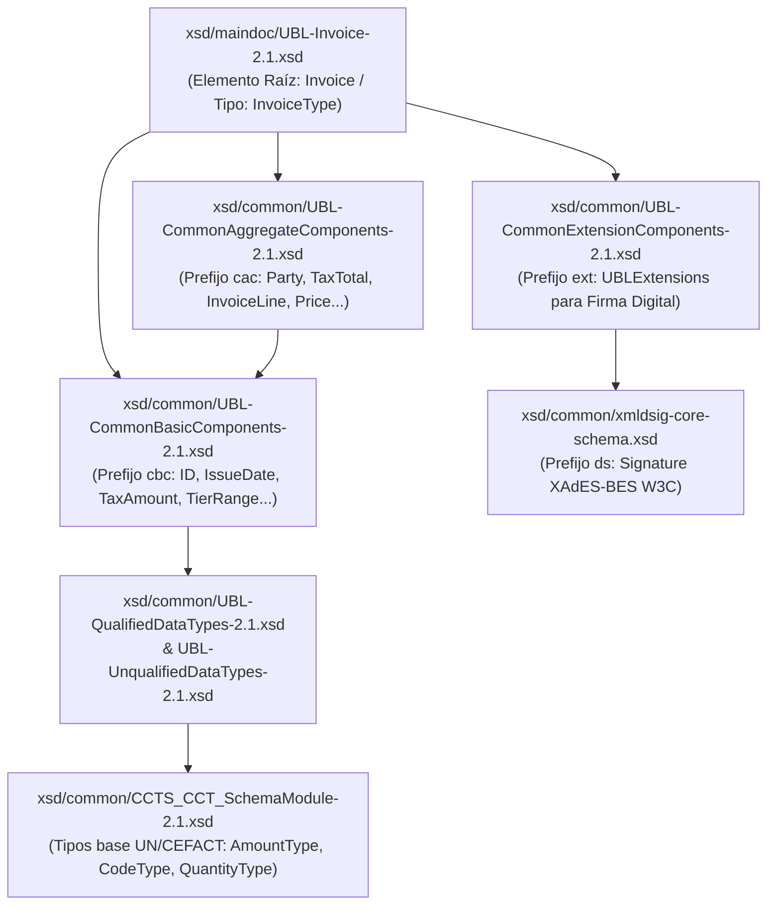
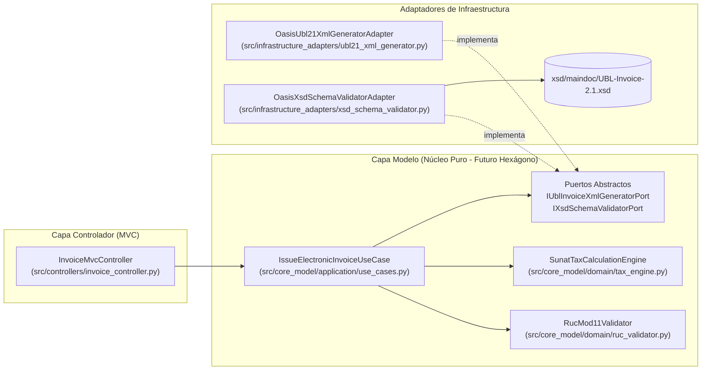

# 5. Implementación del Motor de Generación y Validación XML a partir de `UBL-Invoice-2.1.xsd`

> **Módulo III — De la Especificación (Spec-First) a la Implementación Basada en Esquemas Oficiales OASIS UBL 2.1**
> Documenta el diseño, arquitectura e implementación ejecutable del motor que transforma modelos de dominio tributarios de **ABC Software Corp** en documentos XML firmables y los valida matemáticamente y estructuralmente contra el archivo oficial **`UBL-Invoice-2.1.xsd`**.

---

## 5.1 Anatomía del Esquema Oficial `UBL-Invoice-2.1.xsd` (OASIS)

El estándar **OASIS Universal Business Language (UBL) 2.1** define la estructura legal de la Factura y Boleta Electrónica exigida por la SUNAT mediante un conjunto modular de archivos XSD ubicados en el directorio [`xsd/`](../xsd/):



### Restricción Crítica de `<xs:sequence>` en `UBL-Invoice-2.1.xsd`
En XML Schema (`XSD`), el tipo complejo `InvoiceType` utiliza un indicador de orden `<xs:sequence>`. Esto significa que **el orden de aparición de las etiquetas XML es innegociable**. Si un generador coloca `<cac:LegalMonetaryTotal>` antes de `<cac:TaxTotal>`, o `<cbc:DocumentCurrencyCode>` antes de `<cbc:Note>`, el validador XSD de la SUNAT/OSE aborta inmediatamente la recepción del comprobante.

Nuestro adaptador [`ubl21_xml_generator.py`](../src/infrastructure_adapters/ubl21_xml_generator.py) implementa estrictamente la secuencia exigida por `UBL-Invoice-2.1.xsd`:

| Orden XSD | Elemento XML en `UBL-Invoice-2.1.xsd` | Cardinalidad XSD | Uso en SUNAT (RS 097-2012 / Anexo N.º 8) |
| :---: | :--- | :---: | :--- |
| **1** | `ext:UBLExtensions` | `0..1` | Contenedor obligatorio para el nodo `ds:Signature` (Firma Digital XAdES-BES). |
| **2** | `cbc:UBLVersionID` | `0..1` | Valor constante `"2.1"`. |
| **3** | `cbc:CustomizationID` | `0..1` | Valor constante `"2.0"` con `@schemeAgencyName="PE:SUNAT"`. |
| **4** | `cbc:ID` | `1..1` | Serie y correlativo (`F001-145` o `B001-890`). |
| **5** | `cbc:IssueDate` | `1..1` | Fecha de emisión `YYYY-MM-DD`. |
| **6** | `cbc:IssueTime` | `0..1` | Hora de emisión `HH:MM:SS`. |
| **7** | `cbc:DueDate` | `0..1` | Fecha de vencimiento (opcional en contado, relevante en crédito). |
| **8** | `cbc:InvoiceTypeCode` | `0..1` | **Catálogo 01** (`01` Factura, `03` Boleta) + `@listID` con **Catálogo 51** (`0101`). |
| **9** | `cbc:Note` | `0..n` | **Catálogo 52** (`@languageLocaleID="1000"` Monto en letras, `"1002"` Gratuitas). |
| **10** | `cbc:DocumentCurrencyCode` | `0..1` | **Catálogo 02** (`PEN` o `USD`). |
| **11** | `cac:Signature` | `0..n` | Referencia a la firma del emisor (`#SignABCSoftware`). |
| **12** | `cac:AccountingSupplierParty` | `1..1` | Emisor (**ABC Software Corp**, RUC validado, Ubigeo y Anexo `"0000"`). |
| **13** | `cac:AccountingCustomerParty` | `1..1` | Cliente adquirente (**Catálogo 06**: `6`=RUC, `1`=DNI, `0`=Clientes Varios). |
| **14** | `cac:PaymentTerms` | `0..n` | Forma de pago (`Contado` o `Credito` + desglose de `Cuota001..CuotaN`). |
| **15** | `cac:TaxTotal` | `0..n` | Sumatoria de impuestos y subtotales por tributo (**Catálogo 05**: `1000`, `2000`, `7152`, `9996`, `9997`). |
| **16** | `cac:LegalMonetaryTotal` | `1..1` | Valor venta total, precio venta total e importe total a pagar (`PayableAmount`). |
| **17** | `cac:InvoiceLine` | `1..n` | Líneas de detalle de mercadería con su respectivo `PricingReference`, `TaxTotal` (incluyendo **Catálogo 08 ISC** en `cbc:TierRange`), `Item` y `Price`. |

---

## 5.2 Arquitectura del Código Implementado (MVC Limpio Desacoplado por Puertos)

Siguiendo al pie de la letra la especificación arquitectónica del [Entregable 2](./02-arquitectura-mvc-a-hexagonal.md), la implementación en [`src/`](../src/) separa el **Controlador**, el **Núcleo del Modelo (Dominio + Casos de Uso + Puertos)** y los **Adaptadores de Infraestructura**:



### Responsabilidades de Cada Módulo Implementado

1. **[`src/core_model/domain/ruc_validator.py`](../src/core_model/domain/ruc_validator.py)**:
   - Implementa el **Algoritmo Módulo 11** oficial de la SUNAT (pesos `[5, 4, 3, 2, 7, 6, 5, 4, 3, 2]`, prefijos `10, 15, 16, 17, 20`) y valida las reglas de negocio del **Catálogo 06** (exigencia de RUC en Facturas y DNI en Boletas mayores a S/ 700.00).
2. **[`src/core_model/domain/tax_engine.py`](../src/core_model/domain/tax_engine.py)**:
   - Motor matemático con aritmética decimal exacta (`decimal.Decimal` con `ROUND_HALF_UP`) que calcula:
     - **IGV (18% - Tributo `1000`)**, **Exonerado (`9997`)**, **Inafecto (`9998`)** y **Transferencias Gratuitas / Bonificaciones (`9996`)** según el **Catálogo 07**.
     - **ISC (Tributo `2000`)** soportando los 3 sistemas del **Catálogo N.º 08 de SUNAT**:
       - `01`: Sistema al Valor (`TierRange = 01`).
       - `02`: Aplicación del Monto Fijo en Soles por unidad/litro (`TierRange = 02`).
       - `03`: Sistema de Precios de Venta al Público (`TierRange = 03`).
     - **ICBPER (Tributo `7152`)** para bolsas plásticas (`cbc:BaseUnitMeasure` y `cbc:PerUnitAmount`).
3. **[`src/infrastructure_adapters/ubl21_xml_generator.py`](../src/infrastructure_adapters/ubl21_xml_generator.py)**:
   - Construye el árbol DOM/XML con `lxml.etree` siguiendo la secuencia exacta de `UBL-Invoice-2.1.xsd`, inyectando todos los namespaces (`xmlns`, `cac`, `cbc`, `ext`, `ds`), atributos de catálogos SUNAT y cálculo del `DigestValue` (Hash SHA-256) y cadena QR.
4. **[`src/infrastructure_adapters/xsd_schema_validator.py`](../src/infrastructure_adapters/xsd_schema_validator.py)**:
   - Carga el archivo [`xsd/maindoc/UBL-Invoice-2.1.xsd`](../xsd/maindoc/UBL-Invoice-2.1.xsd) junto con todas sus dependencias XSD locales y ejecuta la validación estructural completa, devolviendo la conformidad o la línea exacta de cualquier infracción al estándar OASIS.

---

## 5.3 Guía Paso a Paso desde Cero: Instalación, Ejecución y Pruebas

### Paso 0: Requisitos Previos
- **Python 3.10 o superior** instalado en el sistema (`python --version`).
  - En Windows puede instalarse desde [python.org](https://www.python.org/downloads/) o ejecutando `winget install -e --id Python.Python.3.12`.
- **Git** (opcional, también se puede descargar el repositorio como archivo `.zip` desde GitHub).

### Paso 1: Clonar el Repositorio e Ingresar a la Carpeta
```bash
git clone https://github.com/ComoCuandoQue/Estrada_Irazabal_Rolando_Victor_Arquitecura_De_Software.git
cd Estrada_Irazabal_Rolando_Victor_Arquitecura_De_Software
```

### Paso 2: Instalar las Dependencias (`requirements.txt`)
El proyecto incluye el archivo [`requirements.txt`](../requirements.txt) con las 3 librerías requeridas (`lxml` para construcción y validación XSD, `cryptography` para la firma digital RSA-SHA256 X.509 y `xmlschema`):
```bash
pip install -r requirements.txt
```
*(O directamente: `pip install lxml cryptography xmlschema`)*

### Paso 3: Ejecutar el Generador y Validador Interactivo
Desde la raíz del repositorio, ejecuta:

```bash
python -m src.demo_generate_and_validate
```

Este comando ejecuta **4 escenarios completos de ABC Software Corp**, genera los archivos XML firmados criptográficamente con `RSA-SHA256` + Certificado `X.509` en la carpeta [`output/`](../output/) y los valida en tiempo real contra `xsd/maindoc/UBL-Invoice-2.1.xsd`:
- **Escenario 1 ([`output/20555999110-01-F001-145.xml`](../output/20555999110-01-F001-145.xml))**: Factura Mayorista al Contado con Arroz Extra (Gravado `10`), Pack de Gaseosas (afecto a **ISC Catálogo 08 = `01` Sistema al Valor** + IGV), Bolsas Plásticas (**ICBPER `7152`**) y Botella de Aceite en **Bonificación Gratuita (`Catálogo 07 = 15`, Tributo `9996`)**.
- **Escenario 2 ([`output/20555999110-01-F001-146.xml`](../output/20555999110-01-F001-146.xml))**: Factura Mayorista al **Crédito en 2 Cuotas** (RS N.º 193-2020/SUNAT) con Licores afectos a **ISC Catálogo 08 = `02` (Monto Fijo)** y Cervezas afectas a **ISC Catálogo 08 = `03` (Precio de Venta al Público)**.
- **Escenario 3 ([`output/20555999110-03-B001-890.xml`](../output/20555999110-03-B001-890.xml))**: Boleta de Venta Minorista con DNI, productos gravados y exonerados (`Catálogo 07 = 20`, Tributo `9997`).
- **Escenario 4 ([`output/20600695771-01-F001-145.xml`](../output/20600695771-01-F001-145.xml))**: Factura homologada para pruebas en vivo en **`https://probar-xml.nubefact.com/`**, cuya Constancia de Recepción oficial (**CDR `ResponseCode = 0`**) se conserva en [`output/R-20600695771-01-F001-145-cdr-sunat.xml`](../output/R-20600695771-01-F001-145-cdr-sunat.xml).

### Paso 4: Ejecutar la Suite de Pruebas Automatizadas (Unitarias + Validación XSD)

```bash
python -m unittest discover -s tests -v
```

---

## 5.4 Verificación Externa en Vivo (`https://probar-xml.nubefact.com/`) y Reglas Superadas

El XML generado fue sometido al validador en línea de **Nubefact / SUNAT (`https://probar-xml.nubefact.com/`)**, superando las siguientes validaciones normativas:

| Código Regla SUNAT / OSE | Descripción de la Validación | Cumplimiento en Nuestro Motor |
| :---: | :--- | :--- |
| **Regla `0306`** | El elemento `ext:ExtensionContent` debe contener obligatoriamente la firma digital `ds:Signature` con `ds:KeyInfo/ds:X509Data/ds:X509Certificate`. | Implementado en [`ubl21_xml_generator.py`](../src/infrastructure_adapters/ubl21_xml_generator.py) mediante canonización W3C `C14N`, firma `RSA-SHA256` y certificado `X.509` real. |
| **Regla `3292`** | En líneas de transferencia gratuita/bonificación (`9996`), el nodo `cac:InvoiceLine/cac:TaxTotal/cbc:TaxAmount` debe ser `0.00`, mientras que `cac:TaxSubtotal/cbc:TaxAmount` conserva el tributo referencial. | Implementado en [`tax_engine.py`](../src/core_model/domain/tax_engine.py). |
| **Regla `3277`** | En el subtotal global de IGV (`1000`), `cbc:TaxableAmount` debe ser igual a la sumatoria de `cbc:LineExtensionAmount` de las líneas gravadas (`1550.20`), mientras que `cbc:TaxAmount` aplica el `18%` sobre `ValorVenta + ISC` (`285.79`). | Implementado en [`tax_engine.py`](../src/core_model/domain/tax_engine.py). |
| **CDR `ResponseCode = 0`** | Emisión de Constancia de Recepción `<ar:ApplicationResponse>` aceptada sin observaciones. | Evidencia almacenada en [`output/R-20600695771-01-F001-145-cdr-sunat.xml`](../output/R-20600695771-01-F001-145-cdr-sunat.xml): *"La Factura numero F001-145, ha sido aceptada"*. |
